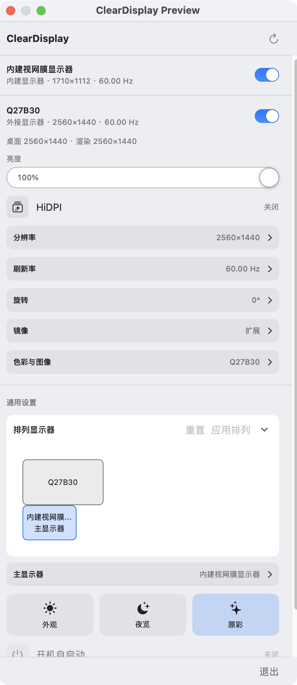

# ClearDisplay

ClearDisplay is a macOS menu bar app for managing displays on Apple Silicon Macs. It brings resolution, refresh rate, brightness, display arrangement, and selected color controls into one panel. The app is still in development and is suitable for testing on your own hardware. A signed and notarized release is not available yet.

## Screenshots

This screenshot shows the running Debug preview, which uses the same controls as the menu bar panel. Available controls and values depend on the connected displays.



## Requirements and installation

- An Apple Silicon Mac running macOS 14 or later.
- Direct distribution outside the Mac App Store.

To install from `ClearDisplay-VERSION-arm64.dmg`, open the image and drag `ClearDisplay.app` to the Applications shortcut. For the ZIP package, extract it and move `ClearDisplay.app` to Applications. Open the app from Applications; ClearDisplay appears as a display icon in the menu bar and has no persistent main window. Click the icon to open its controls.

You can also build a test copy from source using the instructions below. macOS may require you to allow an unsigned build in System Settings → Privacy & Security before opening it.

## Using ClearDisplay

Open the menu bar panel and select the display you want to adjust. Controls appear or become available according to the selected display and the capabilities reported by macOS.

- **Resolution and HiDPI:** Switch HiDPI on an external display and choose a resolution from the list. The built-in display has no HiDPI switch. The apparent desktop size depends on the selected mode, so note your original setting before changing it.
- **Refresh rate and image:** Choose an available refresh rate. On supported displays, adjust HDR, the color profile, software gamma, and color temperature.
- **Brightness and DDC:** Adjust the built-in display's brightness. On a compatible external display, use DDC brightness, contrast, and color temperature controls.
- **Factory reset:** On a compatible external monitor, the Color & Image section can send the MCCS factory-reset command after confirmation. This may reset brightness, contrast, color, geometry, and other monitor-menu settings. ClearDisplay then rereads available DDC values; the command itself is write-only, so a successful read does not prove every setting reached its factory value. "Restore software adjustments" only returns the app's gamma and software temperature controls to their neutral values.
- **Arrangement and connections:** Drag displays in the layout view and apply their positions. Where available, set the primary display, rotate or mirror a display, and disconnect or reconnect it. Make sure another usable display remains connected before disconnecting one.
- **System display settings:** Switch between Light and Dark appearance, toggle Night Shift, and toggle True Tone. True Tone is a system-wide setting rather than an independent switch for each external display. Its visible effect depends on macOS and the display.

The first Light or Dark appearance change may trigger a macOS Automation permission prompt. If you deny access, review ClearDisplay's permission in System Settings → Privacy & Security → Automation.

Launch at Login is available when the running copy is in Applications. After moving the app there, quit any older copy started from a build folder or disk image and reopen it from Applications. If macOS requests approval, use System Settings → General → Login Items.

## Current limitations

- Color-depth selection is still being investigated. There is no working 8/10/12 bpc selector.
- DDC controls are enabled only when there is one external display with an unambiguous DDC channel. Multiple external displays have not been validated.
- The factory-reset command depends on monitor DDC support and cannot be undone by ClearDisplay. It does not reset macOS color profiles or other software settings.
- Software gamma and color temperature change the CoreGraphics transfer curve. ClearDisplay attempts to restore the previous setting on normal exit or the next launch. Some custom original gamma tables cannot be fully restored by the current method.
- HDR, Night Shift, and True Tone use private macOS interfaces and may need further verification after system updates. Automatic appearance can be detected, but ClearDisplay currently changes only Light and Dark appearance; it does not configure an automatic schedule.
- Virtual displays, picture-in-picture, streaming, and display input-source switching are outside the current scope.

If a control is missing, check whether you selected the built-in or an external display, whether the display supports the feature, and whether the cable or dock passes DDC commands. A display may briefly go black while changing modes. You can use System Settings → Displays to restore an unsuitable setting.

## Development and build

Install Xcode Command Line Tools with `xcode-select --install`. No third-party package manager is required, and full Xcode is optional.

```sh
./build.sh                  # Debug app: build/ClearDisplay.app
./format.sh                 # Format Swift source
./check.sh                  # Strict formatting, C warnings, plist validation, arm64 build
```

`check.sh` builds the app without changing active display settings. Programs under `Tests/` are manual hardware probes. A Debug build can show the menu content in a regular window; its controls still change real display settings:

```sh
CONFIGURATION=debug ./build.sh ./build/preview
CLEARDISPLAY_UI_PREVIEW=1 ./build/preview/ClearDisplay.app/Contents/MacOS/ClearDisplay
```

Project-specific implementation pitfalls and verification rules are recorded in [docs/lessons-learned.md](docs/lessons-learned.md).

## Packaging and release

Both packaging scripts run a Release build themselves; you do not need to run `build.sh` first.

```sh
ALLOW_UNSIGNED=1 ./package.sh       # ZIP
ALLOW_UNSIGNED=1 ./package-dmg.sh   # DMG with an Applications shortcut
SIGN_IDENTITY='Developer ID Application: Your Name (TEAMID)' ./package-dmg.sh
SIGN_IDENTITY='Developer ID Application: Your Name (TEAMID)' NOTARY_PROFILE='ClearDisplay-notary' NOTARIZE=1 ./package-dmg.sh
```

The scripts produce `dist/ClearDisplay-VERSION-arm64.zip` or `.dmg`. The DMG contains `ClearDisplay.app`, an Applications shortcut, and a custom mounted-volume icon. Regenerate the icon with `./tools/make-dmg-icon.sh` if its source changes. `ALLOW_UNSIGNED=1` applies a local ad hoc signature to the complete app bundle so macOS can verify it, but these packages remain unnotarized and are for local testing. Developer ID signing and notarization require your own signing identity and local `notarytool` credentials; do not commit credentials to this repository. Before release, confirm the version and bundle ID in `HiDPIApp/Info.plist`, then verify signing, notarization, and display behavior on the target Mac.

Display modes, brightness, arrangement, mirroring, rotation, connection state, HDR, ICC profiles, DDC, and software image adjustments all require testing on real hardware. Record the original value, make a small change, confirm the readback, restore the original value, and check the result after reconnecting an external display. CI covers static checks and compilation; it does not change display settings.
