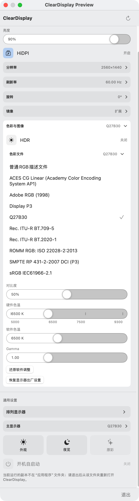
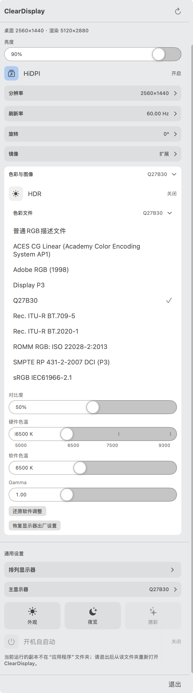

# Menu height verification — 2026-11-17

Checked the Debug build on macOS 27.2.1 (26B131), with one active Q27B30 external display at a logical 2560×1440. The screen's visible height was 1410 points. The installed `/Applications/ClearDisplay.app` was not replaced; checks targeted the separate `build/check/ClearDisplay.app` process.

The implementation measures the full content at its natural height, subtracts measured header/footer height from the host screen budget, and explicitly synchronizes the AppKit window frame. Updates are coalesced on the main queue. The available-height callback only publishes changes, and observers are removed when the sizing view changes windows or is destroyed. Screen changes, screen-parameter changes, and window activation schedule a new size check.

## Observed window sizes

All widths were 390 points. Heights below are actual outer window sizes read through accessibility, not inferred SwiftUI content sizes. The preview includes a title bar.

| State | Debug preview height | Menu bar popup height |
| --- | ---: | ---: |
| Display collapsed | 430 | 402 |
| Display expanded, child sections collapsed | 755 | 727 |
| Resolution expanded | 1198 | 1170 |
| Refresh rate expanded | 1074 | 1046 |
| Rotation expanded | 888 | 860 |
| Mirror expanded | 795 | 767 |
| Color & Image expanded | 1130 | 1102 |
| Arrangement expanded | 785 | 757 |
| Primary Display expanded | 786 | 758 |
| Color profile list expanded, requiring scrolling | 1394 | 1394 |

Each child section was expanded and collapsed separately in both hosts. Each collapse returned to the expanded-display baseline. After the overflow case, collapsing the nested profile list, Color & Image, and display card returned to 430/402 points. The real popup stayed at screen position (2126, 38) during resizing.

## Interaction and scrolling

- Both hosts exposed a vertical scrollbar for the expanded color profile list. Scrolling from 0 to 1 reached the final launch-at-login explanation; the fixed Quit footer remained visible. Screenshots below were captured from the running final build at the bottom of the list.
- Actual mouse clicks expanded the display card. Clicking 3 points inside the resolution row's top-left padding expanded the popup to 1170 points and collapsed it back to 727 points, checking the historical padding hit-target regression.
- Clicking the status item closed and reopened the popup. The expanded overflow popup returned at 1394 points; the collapsed popup returned at 402 points.
- No display setting was changed. No mode, profile, HDR, brightness, color adjustment, connection, arrangement Apply/Reset, or factory-reset action was invoked.

| Debug preview | Real menu bar popup |
| --- | --- |
|  |  |

## Scope

`./format.sh`, `./check.sh`, and `git diff --check` passed. The check script includes an arm64 Debug build and 16 simulated display-recovery scenarios; those scenarios do not validate UI sizing.

Live cross-screen movement, screen-resolution changes, Dock changes, multiple active displays, and other macOS versions were not exercised. Screen notification handling was reviewed in code. The existing README arrangement screenshot remains a reference for multiple-display layout; these new screenshots document the single-display overflow regression without changing hardware configuration.
